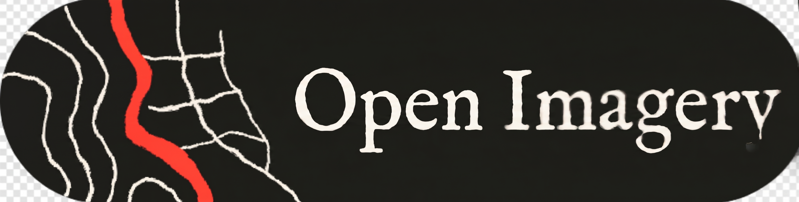
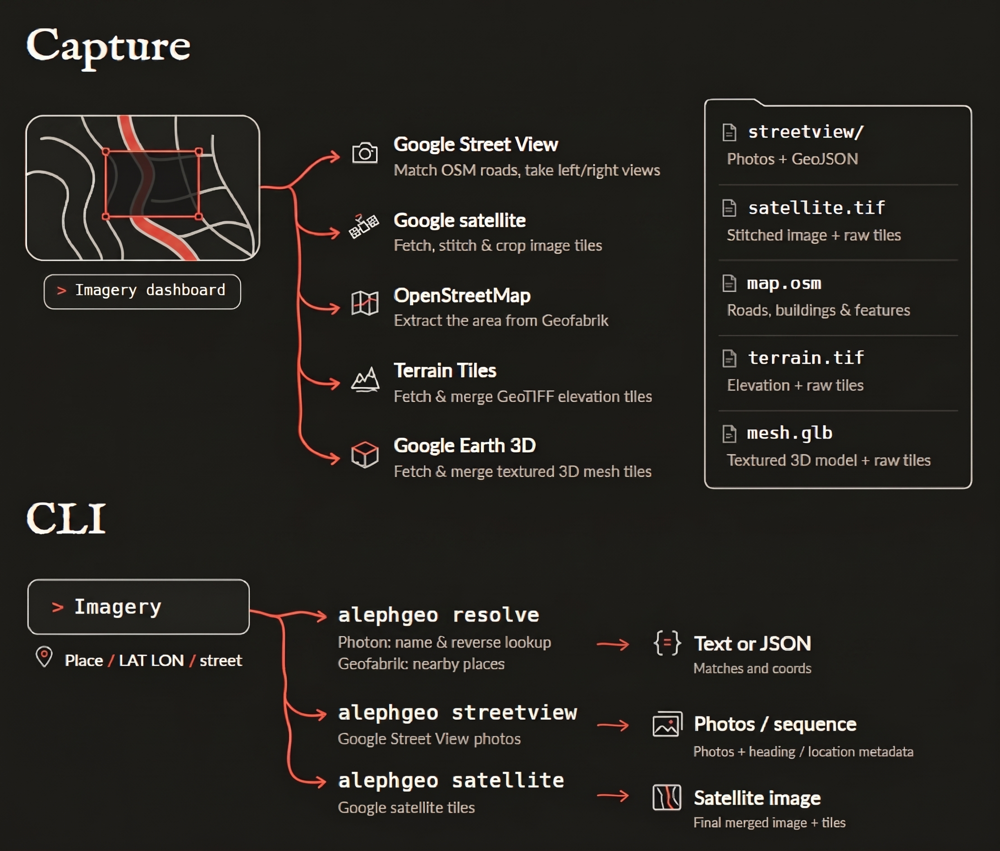

# Open Imagery

<p align="center">
  
</p>

<p align="center">
  <strong>Download high-resolution satellite imagery, 360° Street View panoramas, Google Earth 3D meshes, digital elevation models, and OpenStreetMap data for humans, AI agents, and LLMs — zero API keys required.</strong>
</p>

<p align="center">
  <a href="#system-architecture"></a>
  <a href="https://github.com/smartworldarafath/Open_Imagery/blob/main/LICENSE"></a>
  <a href="https://www.python.org/downloads/"></a>
  <a href="#contributors--acknowledgments"></a>
  <a href="#contributors--acknowledgments"></a>
</p>

<p align="center">
  
</p>

---

## Table of Contents

- [Overview](#overview)
- [System Architecture (Text-Based)](#system-architecture-text-based)
  - [1. High-Level Ingestion & Processing Pipeline](#1-high-level-ingestion--processing-pipeline)
  - [2. Component Interaction & State Flow](#2-component-interaction--state-flow)
  - [3. Spatial Coordinate & Projection Alignment](#3-spatial-coordinate--projection-alignment)
  - [4. Output Directory Schema](#4-output-directory-schema)
- [Core Capabilities](#core-capabilities)
  - [Satellite Imagery (Cloud Optimized GeoTIFF)](#1-satellite-imagery-cloud-optimized-geotiff)
  - [Street View Ground Photography & 360° Spheres](#2-street-view-ground-photography--360-spheres)
  - [Google Earth 3D Photogrammetry Meshes](#3-google-earth-3d-photogrammetry-meshes)
  - [Elevation Models & Terrain Relief](#4-elevation-models--terrain-relief)
  - [OpenStreetMap Vector Extraction](#5-openstreetmap-vector-extraction)
- [Installation & Setup](#installation--setup)
- [Interactive Web Dashboard](#interactive-web-dashboard)
- [Command-Line Interface (CLI) Guide](#command-line-interface-cli-guide)
  - [Quick Downloads](#quick-downloads)
  - [Street Photography & Route Traversal](#street-photography--route-traversal)
  - [Area Captures (Bounding Boxes & Arbitrary Polygons)](#area-captures-bounding-boxes--arbitrary-polygons)
  - [Resuming & Offline Exporting](#resuming--offline-exporting)
  - [Headless Scripting with JSON](#headless-scripting-with-json)
- [Legal & Data Attribution](#legal--data-attribution)
- [Contributors & Acknowledgments](#contributors--acknowledgments)

---

## Overview

**Open Imagery** is a lightweight, zero-configuration geospatial acquisition toolkit and pipeline. It enables developers, spatial data engineers, and autonomous AI agents to ingest high-fidelity data from the physical world. 

Whether extracting a 200-meter street corridor for visual navigation, generating an orthorectified satellite mosaic for GIS modeling, downloading textured 3D glTF building blocks, or packaging full terrain elevation rasters, Open Imagery operates directly without requiring cloud subscriptions or proprietary API keys.

<p align="center">
  
</p>

---

## System Architecture (Text-Based)

### 1. High-Level Ingestion & Processing Pipeline

```
+========================================================================================================+
|                                      OPEN IMAGERY PIPELINE ARCHITECTURE                                |
+========================================================================================================+
|                                                                                                        |
|  [ INVOCATION SURFACES ]                                                                               |
|  +---------------------------------------------+       +--------------------------------------------+  |
|  |       Terminal CLI (openimagery)            |       |      Interactive Web Dashboard (Port 8100) |  |
|  |  • Single-point geocoding & photo sampling  |       |  • OpenFreeMap vector basemap canvas       |  |
|  |  • Street-level sequence generator          |       |  • Interactive BBox & polygon draw tools   |  |
|  |  • Multi-layer area batch capture           |       |  • Real-time download estimate & telemetry |  |
|  |  • Headless automation via --json           |       |  • Three.js / WebGL 3D mesh & DEM preview  |  |
|  +----------------------+----------------------+       +---------------------+----------------------+  |
|                         |                                                    |                         |
|                         +--------------------------+-------------------------+                         |
|                                                    |                                                   |
|                                                    v                                                   |
|  [ CORE ORCHESTRATION & GEOMETRY ENGINE (src/capture.py, src/geo.py) ]                                 |
|  +--------------------------------------------------------------------------------------------------+  |
|  |  • Coordinate Transforms: WGS84 Geodetic (Lat/Lon) <---> Web Mercator Spherical (EPSG:3857)     |  |
|  |  • Boundary Partitioning: Bounding Box envelope computation & ray-casting polygon clipping       |  |
|  |  • Tile Grid Math: Zoom-level slippy tile resolution, span computation & overlap alignment       |  |
|  |  • Estimation Engine: Bandwidth estimation, node counts, and download completion time ETA       |  |
|  |  • Run Manifest Controller: Transactional state recording (manifest.json) & fault recovery      |  |
|  +-------------------------------------------------+------------------------------------------------+  |
|                                                    |                                                   |
|                                                    v                                                   |
|  [ ASYNCHRONOUS TILE WORKERS & CACHE (src/common.py - CachedClient) ]                                  |
|  +--------------------------------------------------------------------------------------------------+  |
|  |  • ThreadPool concurrency controller (1 to 64 parallel workers)                                  |  |
|  |  • Intelligent local disk caching (~/.cache/open-imagery) with automatic content-hash check     |  |
|  |  • Rate-limiting throttle control (--delay) & exponential retry policy                           |  |
|  +-------+---------------------+---------------------+----------------------+-----------------------+  |
|          |                     |                     |                      |                          |
|          v                     v                     v                      v                          v
|  +---------------+   +------------------+   +-------------------+  +------------------+  +-------------------+
|  |  STREET VIEW  |   |    SATELLITE     |   |      3D MESH      |  |  TERRAIN ELEV.   |  |   OSM VECTOR      |
|  | • Panoid probe|   | • Slippy tiles   |   | • Octree traversal|  | • AWS Terrarium  |  | • Overpass / PBF  |
|  | • 360° Spheres|   | • WebM / JPEG    |   | • LOD levels 1-22 |  | • Float32/Int16  |  | • Road graph      |
|  | • FOV & Pitch |   | • Alpha polygon  |   | • Geometry decode |  | • Hillshade      |  | • Building bounds |
|  |   projection  |   |   masking        |   | • UV texture bind |  |   relief raster  |  | • POI resolution  |
|  +-------+-------+   +--------+---------+   +---------+---------+  +--------+---------+  +---------+---------+
|          |                    |                       |                     |                      |
|          +--------------------+-----------------------+---------------------+----------------------+
|                                                    |
|                                                    v
|  [ COMPOSITE EXPORTERS & PACKAGERS (src/mesh.py, src/satellite.py, src/terrain.py, src/pbf.py) ]
|  +--------------------------------------------------------------------------------------------------+
|  |  • Cloud-Optimized GeoTIFF (COG): Lossless RGBA TIFF with internal pyramid overviews (EPSG:3857) |
|  |  • Orthorectified Raster Mosaic: Edge-blended satellite.png cropped to polygon boundary          |
|  |  • Metric Digital Elevation Model: terrain.tif containing real-world elevation in meters          |
|  |  • Textured Binary 3D Mesh: mesh.glb standardized to glTF 2.0 with local tangent metric coords   |
|  |  • Native Vector Map: Clean map.osm XML extract ready for QGIS, Blender GIS, or OSM routing      |
|  |  • Ground Perspective Imagery: Individual photos and equirectangular spherical panoramas         |
|  +-------------------------------------------------+------------------------------------------------+
|                                                    |
|                                                    v
|                                    [ LOCAL RUN DIRECTORY ARTIFACTS ]
+========================================================================================================+
```

---

### 2. Component Interaction & State Flow

```
                      +-----------------------------+
                      | User Input: BBox or Polygon |
                      +--------------+--------------+
                                     |
                                     v
                      +-----------------------------+
                      |   Pre-flight Plan Phase     |
                      |  - Resolves spatial bounds  |
                      |  - Estimates tile volume    |
                      |  - Prompts confirmation     |
                      +--------------+--------------+
                                     |
                     +---------------+---------------+
                     |                               |
          (Execute Capture)                  (Save Plan Only)
                     v                               v
      +-----------------------------+ +-----------------------------+
      |  Multi-Worker Downloader    | |   Plan Serialized into      |
      |  - 1..64 parallel streams   | |       manifest.json         |
      |  - Resumable file parts     | +-----------------------------+
      +--------------+--------------+                |
                     |                               |
           [Network Interrupted?]                    |
           /                    \                    |
         (Yes)                  (No)                 |
          /                        \                 |
         v                          v                v
+------------------+       +------------------------------------+
| State Flushed to |       |        Post-Processing Phase       |
|  manifest.json   |       |  • Stitch tile pyramids            |
+------------------+       |  • Cut polygon boundary mask       |
         |                 |  • Convert Terrarium heights       |
   (Resume via:            |  • Construct glTF scene graph      |
    openimagery            +-----------------+------------------+
    capture resume)                          |
         |                                   v
         +-------------------------> [ Final Offline Assets ]
```

---

### 3. Spatial Coordinate & Projection Alignment

```
 [ WGS84 Geodetic ]              [ Web Mercator EPSG:3857 ]           [ Local Tangent Plane ]
  (Latitude, Longitude)           (Planar Projected Coordinates)       (Metric 3D Carthesian)
 -----------------------         ----------------------------         -----------------------
  • Latitude: -85° to +85°        • X: West to East (Meters)           • X: East (Meters)
  • Longitude: -180° to +180°     • Y: South to North (Meters)         • Y: Up (Elevation, y=0 at min)
  • Primary format for inputs     • Primary format for satellite.tif   • Z: South (Meters)
    and polygon vertices            and terrain elevation rasters      • Standard format for mesh.glb
```

---

### 4. Output Directory Schema

Every capture creates a self-contained, reproducible folder:

```
captures/open-imagery-20261024T230000Z/
├── manifest.json            # Complete configuration, tile manifests, bounding extents, and metadata
├── plan.svg                 # Scaled vector footprint showing bounds, street lines, and photo stops
├── satellite.tif            # Lossless Cloud Optimized GeoTIFF (EPSG:3857) with internal overviews
├── satellite.png            # High-resolution viewable satellite mosaic (alpha masked outside polygon)
├── terrain.tif              # Georeferenced elevation raster (Int16 / Float32 meters above sea level)
├── mesh.glb                 # Google Earth 3D textured mesh in glTF 2.0 binary format
├── map.osm                  # Native OpenStreetMap vector XML extract
├── satellite/
│   ├── patches/             # Raw downloaded tile patches
│   └── plan.svg             # Satellite coverage footprint
├── terrain/
│   └── tiles/               # Raw elevation tiles preserved for instantaneous offline re-export
├── mesh/
│   └── nodes/               # Octree block definitions preserved for offline reconstruction
└── streetview/
    ├── photos/              # Street View photos and 360° spherical panoramas (.jpg / .png)
    ├── data.geojson         # Point features with panorama IDs, timestamps, and camera headings
    └── plan.svg             # Path trace with camera stop indicators
```

---

## Core Capabilities

### 1. Satellite Imagery (Cloud Optimized GeoTIFF)
- Multi-threaded tile assembly across zoom levels 1 through 21 (sub-meter resolution).
- Lossless RGBA Cloud Optimized GeoTIFF generation in EPSG:3857 projection with internal overview downsamples.
- Crisp boundary masks: pixels outside irregular polygons are cleared with 100% transparency.

### 2. Street View Ground Photography & 360° Spheres
- Precise camera targeting via geographic coordinates, place names, or street routes.
- Flexible field-of-view (FOV 5°–175°), pitch angle, and heading orientation.
- Full 360° equirectangular panoramas at adjustable resolutions (zoom levels 0–5).
- Route traversal: sample street corridors with uniform meter spacing or fixed stop counts along road centerlines.

### 3. Google Earth 3D Photogrammetry Meshes
- Extracts full-fidelity 3D meshes from Google Earth photogrammetry octrees down to detail level 22 (~4 cm/texel).
- Outputs standard glTF 2.0 (`.glb`) models with baked original textures and lighting.
- Automatic skirt and occluded triangle decimation for clean polygon boundaries.

### 4. Elevation Models & Terrain Relief
- Downloads metric Digital Elevation Models (DEM) powered by open AWS Terrain Tiles.
- Dynamically outputs Int16 or Float32 georeferenced GeoTIFFs containing absolute height values.
- Built-in hillshade relief processing for 3D topology inspection in the web dashboard.

### 5. OpenStreetMap Vector Extraction
- Queries street networks, building footprints, boundaries, and points of interest.
- Saves standard `map.osm` XML extracts without requiring external conversion tools.

---

## Installation & Setup

### Requirements
- **Python**: 3.11 or higher
- **Core Dependencies**: `Pillow >= 10.0`, `numpy >= 1.25`
- **Zero API keys**: No credit card, token, or vendor account required.

### 1. Clone & Set Up Virtual Environment

```bash
git clone https://github.com/smartworldarafath/Open_Imagery.git
cd Open_Imagery

python3 -m venv .venv
# On Linux / macOS:
source .venv/bin/activate
# On Windows (PowerShell):
.venv\Scripts\Activate.ps1
```

### 2. Install Package

```bash
pip install -e .
```

Verify the installation:

```bash
openimagery --help
# Or use the legacy alias:
alephgeo --help
```

---

## Interactive Web Dashboard

Launch the browser-based graphical console:

```bash
openimagery dashboard -o captures
```

- Navigate to `http://127.0.0.1:8100` in your browser.
- **Draw**: Use polygon or rectangle tools on the map canvas.
- **Select Layers**: Toggle Street View, Satellite, 3D Mesh, Terrain, or OpenStreetMap.
- **Inspect**: Review real-time tile counts, download size estimates, and elapsed time.
- **Explore**: Switch into the integrated WebGL 3D viewer to rotate and examine textured meshes and elevation relief.

---

## Command-Line Interface (CLI) Guide

### Quick Downloads

```bash
# Download Street View photo near a landmark
openimagery streetview --place "Colosseum, Rome" --best-match -o captures

# Download satellite image of a 250m x 250m area
openimagery satellite --place "Eiffel Tower, Paris" --best-match --size 250 -o captures

# Resolve coordinates and search points of interest
openimagery resolve "Times Square, New York"
openimagery resolve --at 40.7580 -73.9855 --nearby --radius 150
```

### Street Photography & Route Traversal

```bash
# Capture 10 evenly spaced forward-facing photos along a street
openimagery streetview --street "Broadway, New York" --best-match --stops 10 -o captures

# Capture both sides of the street with 15-meter spacing
openimagery streetview --street "Champs-Elysees, Paris" --best-match --step 15 --view both -o captures

# Download a full 360° spherical panorama at high resolution
openimagery streetview --at 48.8584 2.2945 --full-sphere --sphere-zoom 4 -o captures
```

### Area Captures (Bounding Boxes & Arbitrary Polygons)

```bash
# Capture all layers (satellite, streetview, terrain, osm) in a rectangle
openimagery capture create --bbox 41.8895 12.4910 41.8910 12.4940 -o captures

# Capture textured 3D photogrammetry mesh and high-res satellite
openimagery capture create --bbox 41.8895 12.4910 41.8910 12.4940 --sources mesh satellite --mesh-level 21 -o captures

# Capture an arbitrary non-rectangular polygon (lat lon pairs in order)
openimagery capture create --polygon 41.8895 12.4910 41.8910 12.4915 41.8905 12.4940 41.8893 12.4932 -o captures
```

### Resuming & Offline Exporting

If network connectivity is interrupted, captures can be seamlessly resumed without redownloading existing tiles:

```bash
# Resume an incomplete download
openimagery capture resume captures/open-imagery-20261024T230000Z

# Re-render satellite.tif, satellite.png, and mesh.glb completely offline
openimagery capture export captures/open-imagery-20261024T230000Z
```

### Headless Scripting with JSON

Integrate directly into Python scripts, automation agents, or CLI pipes with `--json`:

```bash
openimagery satellite --at 35.6586 139.7454 --size 300 -o captures --json > result.json
```

---

## Legal & Data Attribution

- **Street View, Satellite Imagery, 3D Meshes**: © Google and its third-party data providers. Downloading and scraping data may be subject to platform terms of service. This project is not affiliated with or endorsed by Google. You are responsible for complying with all applicable terms and regulations.
- **OpenStreetMap Data & Geocoding**: Distributed under the [Open Database License (ODbL)](https://opendatacommons.org/licenses/odbl/). Credit must be attributed to "© OpenStreetMap contributors".
- **Terrain Elevation Tiles**: Open data powered by [AWS Terrain Tiles](https://github.com/tilezen/joerd/blob/master/docs/attribution.md).

---

## Contributors & Acknowledgments

- **[Arafath](https://github.com/smartworldarafath)** — Creator, Lead Developer, and Maintainer
- **[Google Jules](https://jules.google)** — Autonomous Cloud CI/CD and Maintenance Agent
- **[jcode](https://github.com/smartworldarafath)** — High-throughput Rust execution and evaluation harness

---

<p align="center">
  <sub>Open Imagery — Built with craftsmanship for researchers, cartographers, and AI systems.</sub>
</p>
